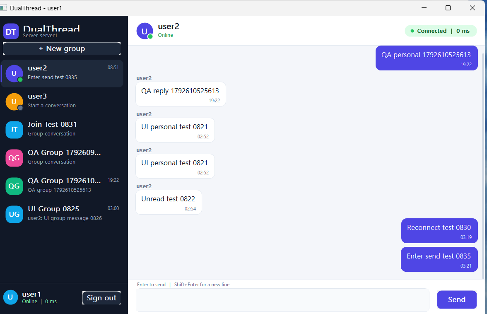

# DualThread

DualThread is a Windows desktop chat application built with **C++17, MFC, Winsock2, Redis, Apache Kafka and MySQL**. It supports personal and group conversations across two independent chat servers, with presence, typing indicators, unread badges, message history, automatic reconnection and durable message storage.



## Highlights

- Native MFC desktop UI (1200 x 780 default outer window, approximately 1200 x 750 client area, resizable, minimum 980 x 640).
- Personal conversations and group conversations in one conversation list.
- Online/offline presence dots and “user is typing...” feedback.
- Unread badges with message previews and timestamps.
- Group creation, group joining, membership synchronisation and group history.
- Server-side message history for the last 100 messages per conversation.
- Automatic TCP reconnection with exponential backoff and clear UI feedback.
- UDP heartbeat/RTT monitoring.
- Redis authentication cache and Redis Pub/Sub routing between servers.
- Kafka event pipeline and a dedicated `DBWriter` process for MySQL persistence.
- Native MySQL access through **ODBC** (`odbc32.lib`); no JDBC and no MySQL Connector/C++ classes.
- Worker threads never touch MFC controls. Frames, status changes and heartbeat results are posted to the UI thread.

## Architecture at a glance

```text
                         UDP heartbeat (5001)
 ChatClient  --------------------------------> LoadBalancer
     |                                              |
     | TCP 5000                                     | UDP 7001 / 7002
     v                                              v
 LoadBalancer ---- TCP 6001 ----> ChatServer 1 ----> UDP heartbeat listener
     |
     +----------- TCP 6002 ----> ChatServer 2 ----> UDP heartbeat listener
                                      |
                    Redis Pub/Sub     |      Kafka topic "chat-messages"
              chat.broadcast / chat.presence
                    |                 |                 |
                    +-----------------+-----------------+
                                      |
                                      v
                                  DBWriter  ----> MySQL / ChatDatabase
```

- Clients connect to the load balancer on **TCP 5000** and send UDP heartbeats to **5001**.
- The load balancer routes new TCP sessions round-robin to healthy backends on **6001/6002** and forwards heartbeat traffic to **7001/7002**.
- Each chat server authenticates against Redis first and falls back to MySQL. Redis keys are `chat:user:<userId>` and `chat:online:<userId>`.
- Cross-server personal messages, group messages, typing events, presence and group membership changes travel on Redis Pub/Sub channels `chat.broadcast` and `chat.presence`.
- Chat servers publish accepted messages to Kafka topic `chat-messages`.
- `DBWriter` consumes the topic and inserts rows into `ChatDatabase.tbl_ChatDetails`.

The detailed design is in [docs/ARCHITECTURE.md](docs/ARCHITECTURE.md).

## Ports and processes

| Process | TCP | UDP | Purpose |
|---|---:|---:|---|
| MySQL | 3306 | - | Users, groups, chat history |
| Redis / Memurai | 6379 | - | Auth cache, presence and Pub/Sub |
| Kafka broker | 9092 | - | Durable message pipeline |
| LoadBalancer | 5000 | 5001 | Client entry point, backend health checks |
| ChatServer 1 | 6001 | 7001 | First chat backend |
| ChatServer 2 | 6002 | 7002 | Second chat backend |
| DBWriter | - | - | Kafka consumer and MySQL writer |

## Repository layout

| Path | Contents |
|---|---|
| `ChatClient/` | MFC client, custom GDI+ controls, login, session and reconnection logic |
| `ChatServer/` | TCP server, authentication, routing, groups, presence, Redis and Kafka integration |
| `LoadBalancer/` | Round-robin TCP proxy, health checks and UDP heartbeat forwarding |
| `DBWriter/` | Kafka consumer and native ODBC MySQL writer |
| `Common/` | Framing protocol, JSON, INI, SHA-256, logger and thread-safe queue |
| `config/` | Runtime INI files for both servers, load balancer, DBWriter and client |
| `database/` | Schema, group migration and demo data |
| `docs/` | Step-by-step execution guide, architecture, traceability, test results and screenshots |
| `scripts/` | Start/stop helpers for the background services |
| `bin/Release/` | Built executables and runtime DLLs |

## Prerequisites

### Build machine

- Windows 10 or Windows 11, x64.
- **Visual Studio 2026** with:
  - Desktop development with C++.
  - C++ MFC for the latest v145 build tools.
  - Windows 10/11 SDK.
- The supplied projects use platform toolset **v145** (`$(VCTargetsPath)` from Visual Studio 18.x). If you use Visual Studio 2022, retarget all four projects to **v143** before building.
- `vcpkg` at `C:\vcpkg` (or another path) and the `VCPKG_ROOT` environment variable pointing to it.
- C++ dependencies: `hiredis:x64-windows` and `librdkafka:x64-windows`.
- MySQL Connector/ODBC 64-bit for the server and DBWriter.

### Runtime dependencies

- MySQL Server 8.0 with a database named `ChatDatabase`.
- Redis or Memurai on `127.0.0.1:6379`.
- Apache Kafka broker on `127.0.0.1:9092`.
- The Visual C++ Redistributable matching the compiler if you run the prebuilt `bin/Release` binaries on another machine.

## Build from source

Open **x64 Native Tools Command Prompt for VS 2026** (or a Developer PowerShell) and run:

```powershell
# 1. Point the projects at the vcpkg installation.
setx VCPKG_ROOT "C:\vcpkg"
# Open a new terminal after setx, or set it for the current session:
$env:VCPKG_ROOT = "C:\vcpkg"

# 2. Install the libraries the projects link against.
Set-Location C:\vcpkg
.\vcpkg install hiredis:x64-windows librdkafka:x64-windows

# 3. Build the solution.
Set-Location C:\assessment\Cpp-Chat-Messaging-System-Advanced-main
& "C:\Program Files\Microsoft Visual Studio\18\Community\MSBuild\Current\Bin\MSBuild.exe" `
  .\CppChatMessaging.sln `
  /t:Rebuild /p:Configuration=Release /p:Platform=x64 /m
```

Replace the solution path with the extracted project path. Build outputs are copied to `bin\Release`:

- `ChatClient.exe`
- `ChatServer.exe`
- `DBWriter.exe`
- `LoadBalancer.exe`
- `hiredis.dll`, `rdkafka.dll`, `lz4.dll`

The solution can also be built from Visual Studio with **Release | x64**.

> The chat servers and DBWriter use native ODBC for MySQL, not `mysql-connector-cpp`. The ODBC driver name is configurable in `config/server1.ini`, `config/server2.ini` and `config/dbwriter.ini`. The verified driver is `MySQL ODBC 26.7 ANSI Driver`.

## Database setup

Create the schema and the optional demo users once:

```powershell
$mysql = "C:\Program Files\MySQL\MySQL Server 8.0\bin\mysql.exe"
Set-Location C:\assessment\Cpp-Chat-Messaging-System-Advanced-main

# Fresh database. The mysql client prompts for the root password.
& $mysql -uroot -p -e "source database/schema.sql"

# Optional demo users and demo rows. Run only on a fresh database.
& $mysql -uroot -p -e "source database/sample_data.sql"
```

For an existing database created by the earlier version of this project, apply the idempotent migration instead of re-running the full schema:

```powershell
& $mysql -uroot -p -e "source database/migration_v2_groups.sql"
```

Demo credentials created by `sample_data.sql`:

| User | Password |
|---|---|
| `user1` | `pass123` |
| `user2` | `pass123` |
| `user3` | `pass456` |

The checked-in configs use MySQL user `root` and password `Tamil123%`. Change those values in all three service configs if your MySQL installation differs. `DBWriter` also accepts the `CPPCHAT_MYSQL_PASSWORD` environment variable, which overrides `mysql_password` from its INI file.

## Start the system

### Option A: helper scripts

```powershell
Set-Location C:\assessment\Cpp-Chat-Messaging-System-Advanced-main
powershell -ExecutionPolicy Bypass -File .\scripts\start-all.ps1
```

The script:

- starts `MySQL80` and `Memurai` services when they are stopped (run PowerShell as Administrator for this),
- starts Kafka if `127.0.0.1:9092` is not already listening,
- starts `DBWriter`, both chat servers and the load balancer as hidden background processes,
- writes service stdout/stderr to `logs\*.out.log` and `logs\*.err.log`,
- verifies the listening ports and prints the process IDs.

Useful variants:

```powershell
# Kafka is already running.
powershell -ExecutionPolicy Bypass -File .\scripts\start-all.ps1 -SkipKafka

# Use a different Kafka installation directory.
powershell -ExecutionPolicy Bypass -File .\scripts\start-all.ps1 -KafkaHome D:\kafka

# Stop DBWriter, both chat servers and the load balancer (Kafka is left running).
powershell -ExecutionPolicy Bypass -File .\scripts\stop-all.ps1

# Stop Kafka as well.
powershell -ExecutionPolicy Bypass -File .\scripts\stop-all.ps1 -StopKafka
```

### Option B: exact manual order

1. **Start MySQL and Redis/Memurai.** The verified service names are `MySQL80` and `Memurai`:

   ```powershell
   Start-Service MySQL80
   Start-Service Memurai
   ```

2. **Start Kafka.** The exact command that works in this environment is:

   ```powershell
   cmd.exe /c "C:\kafka\bin\windows\kafka-server-start.bat C:\kafka\config\server.properties"
   ```

   Run it in its own terminal, or let `scripts\start-all.ps1` launch it hidden and wait for port 9092. Wait until TCP `9092` is listening. If the topic does not exist and your broker has auto-topic creation disabled, create it once:

   ```powershell
   C:\kafka\bin\windows\kafka-topics.bat --bootstrap-server 127.0.0.1:9092 --create --if-not-exists --topic chat-messages --partitions 1 --replication-factor 1
   ```

3. **Initialize the database** (once) using the commands in the previous section.

4. **Start the application services** from the project root. The order below is the verified order:

   ```powershell
   $root = "C:\assessment\Cpp-Chat-Messaging-System-Advanced-main"
   Set-Location $root

   Start-Process .\bin\Release\DBWriter.exe -WorkingDirectory $root -WindowStyle Hidden
   Start-Sleep -Seconds 2
   Start-Process .\bin\Release\ChatServer.exe -ArgumentList "config\server1.ini" -WorkingDirectory $root -WindowStyle Hidden
   Start-Sleep -Seconds 2
   Start-Process .\bin\Release\ChatServer.exe -ArgumentList "config\server2.ini" -WorkingDirectory $root -WindowStyle Hidden
   Start-Sleep -Seconds 2
   Start-Process .\bin\Release\LoadBalancer.exe -ArgumentList "config\loadbalancer.ini" -WorkingDirectory $root -WindowStyle Hidden
   ```

   The three services read from standard input for an optional `q` shutdown command. They detect a closed stdin and keep serving traffic, so `-WindowStyle Hidden` is safe.

5. **Verify the ports:**

   ```powershell
   Get-NetTCPConnection -State Listen -LocalPort 3306,6379,9092,5000,6001,6002 |
     Select-Object LocalAddress,LocalPort,OwningProcess
   ```

6. **Start two clients** (two separate processes for a realistic two-user test):

   ```powershell
   Start-Process .\bin\Release\ChatClient.exe -WorkingDirectory $root
   Start-Process .\bin\Release\ChatClient.exe -WorkingDirectory $root
   ```

   Sign in as `user1 / pass123` and `user2 / pass123`. The server address is `127.0.0.1` and the port is `5000`. The load balancer may place the two users on different chat servers; that is intentional.

## Client usage

1. Enter the server `127.0.0.1`, port `5000`, username and password, then select **Sign in**.
2. Select a person in the left list to open a personal conversation, or select a group to open its history.
3. Type in the multiline composer.
   - **Enter** sends the message.
   - **Shift+Enter** inserts a newline.
4. Select **+ New group**:
   - **Create**: enter a name and optional comma-separated members. The creator is always a member.
   - **Join**: enter an existing group ID.
5. Online users have a green presence dot. A conversation with new messages shows a numeric unread badge; selecting it clears the badge.
6. If the connection drops, the header and profile show **Reconnecting...**, the send button is disabled and the composer text is preserved. The client retries with a 1–10 second backoff. After recovery it refreshes groups, presence and the selected history, then shows **Reconnected. Messages are flowing again.**
7. **Sign out** sends a logout frame, closes the session and returns to the login screen.

## Persistence and messaging semantics

Every accepted personal or group message gets a server-generated `MessageId` and is published to Kafka. `DBWriter` inserts:

| Column | Meaning |
|---|---|
| `UniqueId` | Auto-increment primary key |
| `MessageId` | Server-generated unique message ID |
| `UserId` | Sender |
| `Timestamp` | UTC timestamp (`YYYY-MM-DDTHH:MM:SSZ`) |
| `ChatMessage` | UTF-8 message text |
| `ConversationType` | `personal` or `group` |
| `TargetId` | Recipient user ID for personal, group ID for group |

The client displays its own message immediately and replaces the temporary state when the `ack` frame arrives. History is requested from MySQL when a conversation is opened. The server selects the newest 100 rows, reverses them into chronological order, and sends them as `history_item` frames; the UI appends them.

`DBWriter` commits the Kafka offset only after the MySQL insert succeeds. `MessageId` is unique in `tbl_ChatDetails`. This gives at-least-once delivery from Kafka, with the database uniqueness constraint as the duplicate guard.

## Protocol summary

Frames are UTF-8 JSON objects preceded by a 4-byte big-endian length. The maximum frame size is 16 MiB; chat messages are limited to 8000 characters.

Common client-to-server frames:

| `type` | Important fields | Purpose |
|---|---|---|
| `auth` | `userId`, `password` | Initial authentication |
| `chat` | `to`, `message`, `clientMsgId` | Personal message |
| `group_chat` | `groupId`, `message`, `clientMsgId` | Group message |
| `typing` | `to` or `groupId`, `isTyping` | Typing state |
| `history` | `with` or `groupId`, `limit` | Request history |
| `group_create` | `name`, `members` | Create a group |
| `group_join` | `groupId` | Join a group |
| `group_list` | - | Refresh groups |
| `presence_list` | - | Refresh online users |
| `logout` | - | Sign out |
| UDP `heartbeat` | `userId`, `seq`, `timestamp` | Heartbeat to the load balancer |

Important server-to-client frames include `auth_ok`, `chat`, `group_chat`, `ack`, `error`, `history_item`, `history_end`, `presence`, `presence_list`, `user_list`, `group`, `group_list_end`, `group_created`, `group_joined`, `group_added`, `group_removed`, `typing`, `pong` and `bye`. UDP heartbeat replies use `hb_ack`.

## Data model changes

The original project stored only a sender, timestamp and message text. The current schema adds routed conversation metadata and group tables.

**`tbl_ChatDetails`** now has:

- `ConversationType VARCHAR(16) NOT NULL DEFAULT 'personal'`
- `TargetId VARCHAR(100) NULL` — recipient for personal messages, group ID for group messages
- `idx_conversation (ConversationType, TargetId, UniqueId)`

**New tables:**

- `tbl_Groups (GroupId, GroupName, OwnerId, CreatedAt)`
- `tbl_GroupMembers (GroupId, UserId, JoinedAt)` with a composite primary key and a cascading foreign key in `database/schema.sql`

`database/migration_v2_groups.sql` adds the two conversation columns and the index without deleting existing broadcast rows. Existing rows keep the default `personal` type and a `NULL` target, so they are not replayed into a specific conversation. The migration creates the group tables without a foreign key so it can be applied to databases that already contain inconsistent data; a fresh `schema.sql` installation includes the foreign key.

## Configuration

| File | What to change |
|---|---|
| `config/client.ini` | Load-balancer address and TCP/UDP ports |
| `config/server1.ini` | Server ID, ports, Redis, Kafka and MySQL/ODBC settings |
| `config/server2.ini` | Same for the second backend |
| `config/loadbalancer.ini` | Listen port, UDP port, health checks and backend list |
| `config/dbwriter.ini` | Kafka consumer group, topic and MySQL/ODBC settings |

The servers and DBWriter also support their legacy INI key names for compatibility. Keep the Kafka topic `chat-messages`, Redis channels `chat.broadcast` / `chat.presence` and table names stable if you have existing data.

## Troubleshooting

| Symptom | Check |
|---|---|
| Login says the server refused the connection | LoadBalancer is not running or port 5000 is blocked. Start it after both chat servers. |
| “No authentication response” | Server is running but MySQL/Redis are unreachable. Check `logs/server1.log` and `logs/server2.log`. |
| `IM002` / ODBC driver not found | Install 64-bit MySQL Connector/ODBC and make `odbc_driver` exactly match the installed driver name. |
| Login fails with valid demo credentials | Run `database/schema.sql`, then `database/sample_data.sql`; confirm `tbl_UserDetails` has the users. The server stores SHA-256 hashes. |
| Messages arrive but are never stored | Kafka is not running, the `chat-messages` topic is missing, or DBWriter cannot reach MySQL. Check `logs/dbwriter.log`. |
| Group name shows as an ID | The server returned only a group ID. Restart the client with the current build; `MainDlg::EnsureConversation` keeps a friendly name when one is known. |
| Reconnect loop after stopping the load balancer | Restart the load balancer; the client retries automatically. The header returns to **Connected** and history/presence refresh. |
| Hidden service exits immediately | This build ignores stdin EOF. Run from the project root so `config/*.ini` and `logs/` resolve. |
| Kafka server script fails to start | Use the exact command shown above with no spaces inside the batch path; wait for port 9092. Do not pass the `.bat` path as an unquoted argument with spaces. |

## Verification summary

Verified on 2026-10-22 with two clients, two chat servers, the load balancer, MySQL, Redis/Memurai and Kafka:

- Full `Release|x64` rebuild via MSBuild: **exit 0** (warnings only).
- Personal messaging across servers, group creation/join and cross-server group messaging.
- Presence, typing indicator, unread badges, history, Enter-to-send, logout/re-login.
- Reconnect feedback and recovery after stopping/restarting the load balancer.
- MySQL persistence via DBWriter, including routed personal and group rows.
- `scripts\stop-all.ps1` and `scripts\start-all.ps1`, including a cold start with Kafka stopped: both scripts exited successfully and all expected ports were listening.

The complete evidence table, including the one item that was implemented but not conclusively automated (Shift+Enter newline), is in [docs/TEST_RESULTS.md](docs/TEST_RESULTS.md). Requirement-by-requirement mapping is in [docs/TRACEABILITY.md](docs/TRACEABILITY.md).

## Documentation and screenshots

- [Step-by-step execution guide (PDF)](docs/DualThread-Execution-Guide.pdf)
- [Architecture](docs/ARCHITECTURE.md)
- [Traceability matrix](docs/TRACEABILITY.md)
- [Test results](docs/TEST_RESULTS.md)
- [Login](docs/screenshots/login.png)
- [Personal chat](docs/screenshots/personal-chat.png)
- [Group chat](docs/screenshots/group-chat.png)
- [Typing indicator](docs/screenshots/typing-indicator.png)
- [Unread badge](docs/screenshots/unread-badge.png)
- [Reconnect feedback](docs/screenshots/reconnect-feedback.png)
- [Reconnected](docs/screenshots/reconnected.png)
- [Group joined](docs/screenshots/group-joined.png)

## Security and production notes

This is a local assessment/demo application. Before using it outside a trusted network:

- Replace the demo users and the plaintext MySQL password in the INI files.
- Use a dedicated MySQL account with only the required privileges.
- Put TLS in front of the TCP protocol and secure Redis/Kafka.
- Replace the unsalted SHA-256 password hashes with a salted password KDF.
- Restrict or remove demo data and verbose logs.
